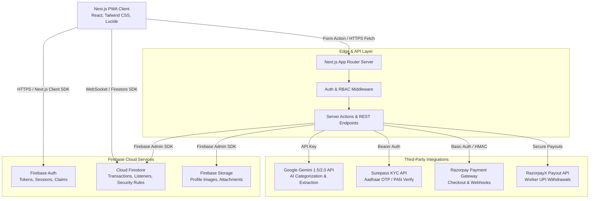
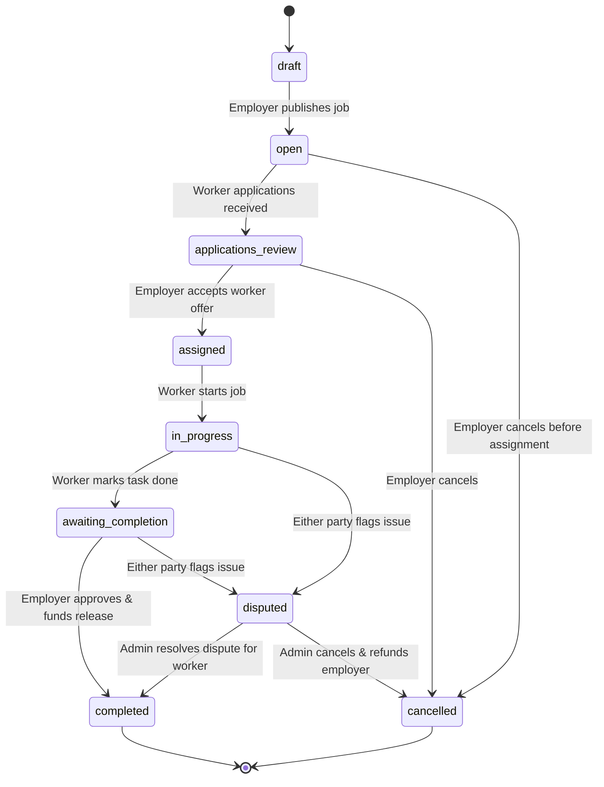
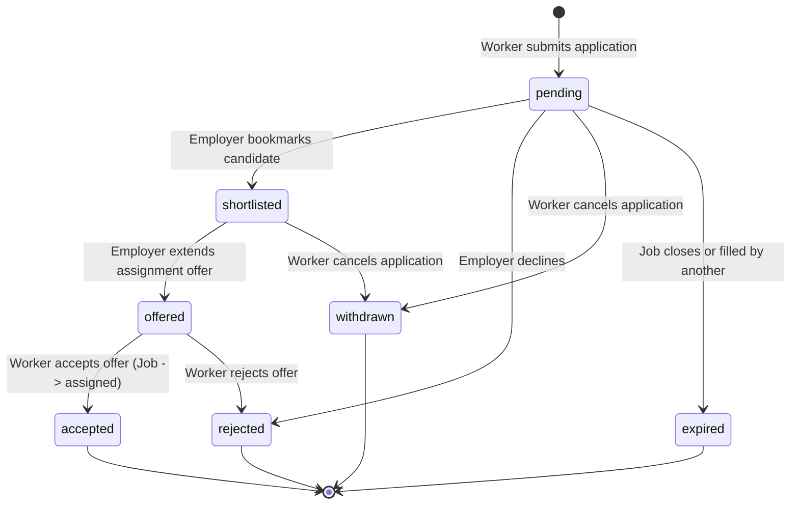

# HelpHun — System Architecture & Design Specification
**Tagline:** Find Help Nearby.  
**System Target:** Hyperlocal Micro-Job Marketplace (India)

---

## 1. High-Level System Architecture



---

## 2. Role-Based Access Control (RBAC) Architecture

HelpHun defines four primary user roles with strict server-enforced boundaries:

| Role | Permissions & Access Scope |
|---|---|
| **Worker (`worker`)** | Browse nearby jobs, apply, accept job offers, execute tasks, receive payments to wallet, request UPI withdrawals, chat with assigned employers, rate employers, submit KYC. Cannot create jobs or view other workers' private bids. |
| **Employer (`employer`)** | Post jobs, use AI categorization, view candidate applications, shortlist, offer jobs, fund escrow/payments via Razorpay, chat with assigned workers, confirm completion, rate workers, dispute orders. Cannot apply to jobs. |
| **Accountant (`accountant`)** | Read-only access to platform transactions, fee balances, withdrawal batches, payment dispute logs, and financial CSV exports. Zero permissions to create wallet adjustments or edit jobs. |
| **Admin (`admin`)** | Full platform oversight, user suspension/reinstatement, KYC manual review, dispute adjudication, category management, platform fee configuration, system audit logs. |

### Role Privilege Enforcement
- Self-registration is strictly restricted to `worker` and `employer`.
- `admin` and `accountant` roles are gated behind Firebase Custom Claims (`role: 'admin'`, `role: 'accountant'`) or trusted Firestore `users` document claims validated server-side by Firebase Admin SDK.

---

## 3. Firestore Data Model & Schema Design

All monetary values are stored in **integer paise** (1 INR = 100 paise) to prevent floating-point rounding errors.

### Core Collections:

#### `users`
```typescript
interface UserDocument {
  id: string; // Firebase Auth UID
  fullName: string;
  email: string;
  phoneNumber: string;
  role: 'worker' | 'employer' | 'accountant' | 'admin';
  preferredLanguage: string; // 'en' | 'hi' | 'ta' | 'te' | 'bn' etc.
  city: string;
  state: string;
  pincode: string;
  isKycVerified: boolean;
  kycStatus: 'not_started' | 'pending' | 'verified' | 'rejected' | 'manual_review';
  status: 'active' | 'suspended' | 'deleted';
  createdAt: FirebaseFirestore.Timestamp;
  updatedAt: FirebaseFirestore.Timestamp;
}
```

#### `workerProfiles`
```typescript
interface WorkerProfileDocument {
  userId: string;
  skills: string[];
  categories: string[];
  bio: string;
  avatarUrl?: string;
  hourlyRatePaise: number;
  workRadiusKm: number;
  workingHours: { start: string; end: string };
  isAvailable: boolean;
  completedJobsCount: number;
  ratingAverage: number; // 0.0 - 5.0
  ratingCount: number;
  location: {
    lat: number;
    lng: number;
    approxArea: string;
    city: string;
  };
}
```

#### `jobs`
```typescript
interface JobDocument {
  id: string;
  employerId: string;
  employerName: string;
  title: string;
  description: string;
  category: string;
  skillsRequired: string[];
  budgetPaise: number;
  budgetType: 'fixed' | 'hourly';
  workersNeeded: number;
  assignedWorkerIds: string[];
  status: 'draft' | 'open' | 'applications_review' | 'assigned' | 'in_progress' | 'awaiting_completion' | 'completed' | 'cancelled' | 'disputed';
  workDate: string; // YYYY-MM-DD
  startTime: string; // HH:mm
  estimatedDurationHours: number;
  specialInstructions?: string;
  location: {
    address: string;
    city: string;
    pincode: string;
    approxLat: number;
    approxLng: number;
  };
  paymentStatus: 'unpaid' | 'authorized' | 'captured' | 'released' | 'refunded';
  razorpayOrderId?: string;
  razorpayPaymentId?: string;
  createdAt: FirebaseFirestore.Timestamp;
  updatedAt: FirebaseFirestore.Timestamp;
}
```

#### `applications`
```typescript
interface ApplicationDocument {
  id: string;
  jobId: string;
  workerId: string;
  workerName: string;
  workerRating: number;
  bidAmountPaise: number;
  coverNote?: string;
  status: 'pending' | 'shortlisted' | 'offered' | 'accepted' | 'rejected' | 'withdrawn' | 'expired';
  createdAt: FirebaseFirestore.Timestamp;
  updatedAt: FirebaseFirestore.Timestamp;
}
```

#### `walletAccounts` & `walletTransactions`
```typescript
interface WalletAccountDocument {
  userId: string;
  availableBalancePaise: number;
  pendingBalancePaise: number;
  lockedBalancePaise: number;
  totalEarnedPaise: number;
  totalWithdrawnPaise: number;
  updatedAt: FirebaseFirestore.Timestamp;
}

interface WalletTransactionDocument {
  id: string;
  userId: string;
  type: 'job_payout' | 'withdrawal_debit' | 'withdrawal_refund' | 'adjustment';
  amountPaise: number;
  balanceAfterPaise: number;
  jobId?: string;
  withdrawalId?: string;
  description: string;
  referenceId: string;
  status: 'pending' | 'completed' | 'failed' | 'reversed';
  createdAt: FirebaseFirestore.Timestamp;
}
```

#### `conversations` & `messages`
```typescript
interface ConversationDocument {
  id: string;
  jobId: string;
  employerId: string;
  workerId: string;
  lastMessage: string;
  lastMessageTimestamp: FirebaseFirestore.Timestamp;
  unreadCountEmployer: number;
  unreadCountWorker: number;
}

interface MessageDocument {
  id: string;
  conversationId: string;
  senderId: string;
  text: string;
  attachmentUrl?: string;
  createdAt: FirebaseFirestore.Timestamp;
  read: boolean;
}
```

---

## 4. State Machines

### 4.1 Job State Lifecycle


### 4.2 Application State Lifecycle


---

## 5. External Provider Integrations

### 5.1 Google Gemini AI Service
- **Endpoint:** Server-Side Next.js API (`/api/ai/categorize`)
- **Model:** `gemini-1.5-flash` or `gemini-2.0-flash`
- **Output:** Structured JSON adhering to Zod schema:
  - `category`: Must match one of 14 strictly enumerated Indian service sectors.
  - `skills`: Array of max 5 concise skill tags.
  - `suggestedBudgetMinPaise`: Estimated fair wage floor.
  - `suggestedBudgetMaxPaise`: Estimated fair wage ceiling.
  - `summary`: Clean 1-sentence synopsis.
- **Fail-safe:** If Gemini fails, rate limits, or credentials are missing, falls back seamlessly to rule-based keyword matching and manual picker.

### 5.2 Surepass KYC Verification
- **Aadhaar OTP Flow:**
  1. Worker enters 12-digit Aadhaar.
  2. Server dispatches request to `POST /api/v1/aadhaar-v2/generate-otp`.
  3. Client enters OTP; server verifies via `POST /api/v1/aadhaar-v2/submit-otp`.
  4. Response returns masked Aadhaar (`XXXX-XXXX-1234`), full name, and age band.
  5. Raw Aadhaar numbers are immediately scrubbed from memory; only verification token and masked ID are persisted.

### 5.3 Razorpay Payment Gateway & Payouts
- **Payment Ingestion:**
  1. Employer initiates checkout; server creates Order (`amount` in paise, `currency`: 'INR').
  2. Standard Razorpay modal opens on client.
  3. Server verifies cryptographic signature:
     `HMAC_SHA256(order_id + "|" + payment_id, RAZORPAY_KEY_SECRET) == signature`.
  4. Webhook listener (`/api/payments/webhook`) validates `X-Razorpay-Signature` against raw body for zero-loss reconciliation.
- **Worker Withdrawals (UPI):**
  1. Worker specifies VPA (e.g. `user@okhdfcbank`) and amount (min ₹100 / 10,000 paise).
  2. Server uses atomic Firestore transaction: decrements `availableBalancePaise`, increments `lockedBalancePaise`.
  3. Payout executed via RazorpayX Payout API or Sandbox Payout Processor.
  4. On payout success, `lockedBalancePaise` is cleared; on failure, funds are atomically reverted to `availableBalancePaise`.
